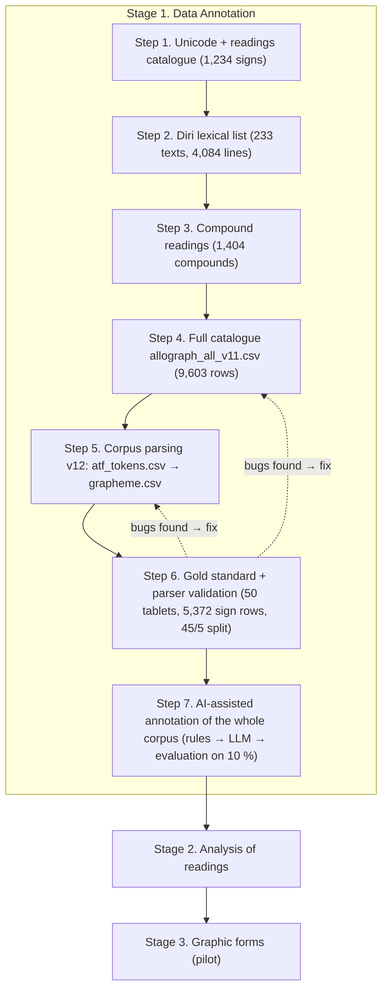

# Annotation Guidelines v2: Gold Standard (Step 6) And AI-Assisted Annotation (Step 7)

*Thesis:* Signs and Their Readings in School and Other Texts of the Old Babylonian Period: A Quantitative Analysis
*Version:* 2.0 (2026-11-09), prepared with Claude. *Changes from v1:* the work is placed in the thesis workflow as two new steps of Stage 1 (**Step 6** and **Step 7**) instead of "Step 5"; the internal labels "Stage A–G" are replaced by sub-steps 6.1–6.8 and 7.1–7.5; the OSL index counts are corrected.
*Status:* the labels are a **gold candidate (silver standard)** until Step 6.8 (human verification) is done.

## 1. Full Workflow

| Stage / step | Status | What it gives |
|---|---|---|
| Stage 1, Steps 1–4 | done | sign catalogue (Unicode, readings, compounds) |
| Stage 1, Step 5 | done (version v12) | first parse of 167 school tablets; not yet validated |
| **Stage 1, Step 6** | **done up to 6.7; 6.8 = manual verification** | gold standard; measured error types of Steps 4–5 |
| **Stage 1, Step 7** | **scripts ready; to be run** | annotated corpus `grapheme.csv` v2 for Stage 2 |
| Stage 2 | next | inventories, Jaccard, network, statistics (only `include_in_analysis = 1`) |
| Stage 3 | pilot | `sign_variant_id` added to the same sign-level format |

*Why two new steps.* Step 6 answers the Open Question "How would you recommend validating the parser?". Step 7 answers the second Open Question: it measures the share of unrecognised signs per corpus, so that differences between corpora can be checked before comparison.

## 2. Step 6: Gold Standard And Parser Validation

*Goal:* a manually verified, stratified sample annotated at the sign level, used (a) to measure the quality of the parser and (b) as examples and test data for the AI of Step 7.

### 6.1 Annotation Decisions

- *Unit:* one row = one sign occurrence (the `grapheme.csv` principle). Compounds written with `.` (|KA₂.GAL| *abul*) give one row per component sharing one `reading_unit_id`; ligatures with ×, &, % are one row.
- *Function:* LOGO / SYLL decided by language and context, not by letter case.
- *Agreed with the supervisor:* DET and NUM are excluded from the analysis but kept in the data (`include_in_analysis = 0`), so the text of the tablet stays complete (CoNLL-U principle).

### 6.2 Diagnosis Of Steps 4 And 5

The existing parse (`atf_tokens.csv`, `grapheme.csv`, scripts v12) was compared with the source ATF and with OSL. Very frequent readings were unresolved (`ka`, `du11`, `inim`, `šum2`, `zu2`), which pointed to a structural cause. The findings are listed in section 4.

### 6.3 Tools (`goldlib.py`, `stage_c_tools.py`)

1. *OSL index.* `osl.asl` is read directly. The file has 11,411 `@v` lines in 3,309 `@sign` entries; after skipping language-tagged lemma values (`%akk …`) the index holds 11,292 value entries (9,776 distinct values) for 4,321 signs and `@form` variants. Priority: value of a sign → value of a `@form` → deprecated `@v-`.
2. *Normalisation of C-ATF:* sz → š, s, → ṣ, t, → ṭ, j / ĝ → ŋ, ḫ → h, final digits → subscripts (du11 → du₁₁), index x → ₓ.
3. *Tokenizer* (tablet → line → word → sign), keeping editorial state: `_..._` switches to the second language of the text (Sumerograms in Akkadian, Akkadian words in Sumerian); `[ ]` restored, `< >` supplied, `<< >>` superfluous, `#` damaged, `?` uncertain, `!` corrected, `*` collated; `{d}` determinative, `{+ga}` phonetic complement, `{{...}}` gloss; `%a` / `%s` language switch and `=` column separator in lexical lists; `reading(SIGN)`, `reading!(SIGN)`, numerals `2(u)`, `1/2(diš)`, modern digits `1.30`.

### 6.4 Stratified Sample (`select_sample.py`, seed 20261109)

Sampling frame: 16,906 OB tablets with ATF and CDLI metadata. Filters: at least 75 % readable signs; 25–260 signs (school) or 30–260 (other); language sux or akk. Missing `#atf: lang` (329 of 717 school tablets): language taken from CDLI `languages`, or Sumerian for lexical lists (`assumed_lexical`). Within each stratum the tablets maximise provenience diversity.

| Stratum (corpus_group) | Tablets | Sign rows | Rows in analysis | LOGO | SYLL |
|---|---|---|---|---|---|
| SCHOOL (is_school_text = 1) | 20 | 1,383 | 1,036 | 604 | 475 |
| ADMINISTRATIVE | 6 | 665 | 530 | 225 | 315 |
| LEGAL | 6 | 795 | 664 | 246 | 434 |
| LETTER | 6 | 899 | 838 | 108 | 744 |
| LITERARY | 4 | 1,013 | 924 | 343 | 614 |
| LEXICAL | 4 | 418 | 358 | 300 | 78 |
| SCHOLARLY | 4 | 199 | 154 | 42 | 116 |
| **Total** | **50** | **5,372** | **4,504** | **1,868** | **2,776** |

- School sub-strata: Lexical 8, Wisdom or proverb 5, Business / Contracts 3, Literary 3, other 1.
- 13 sites plus "uncertain" / no provenience; 32 Sumerian and 18 Akkadian tablets.
- *Proposed genre → corpus mapping* (first listed CDLI genre wins; open question): Lexical, Thematic word list → LEXICAL; Administrative, Account, Receipt → ADMINISTRATIVE; Legal, all Contracts, Inheritance, Judicial, Marriage, Dowries, Adoption → LEGAL; Letter → LETTER; Literary, Wisdom, Prayer, Incantation, Ritual → LITERARY; Mathematical, Scholarly, Divination, Medical → SCHOLARLY; is_school_text = 1 → SCHOOL regardless of genre.

### 6.5 Automatic Annotation (`build_gold.py`)

*Sign identification.* Every piece is resolved against OSL: regular value → `@form` value → deprecated value; qualified readings take the sign in brackets; capitals are looked up as sign names, then as values (ARAD₂ → |ARAD×KUR|). If OSL lists several signs for one value (58 rows: *lil₂*, *he₂*, *idigna* …), the first is kept, the others go to `alt_candidates`, the row is flagged. One preference: *babila₂* → |KA₂.AN.RA|. `x` = UNCLEAR; `[...]`, `...`, `~` produce no row. Only 4 of 5,372 rows remain unresolved.

*Function rules.*
- **LOGO**: the sign writes a word or lexical morpheme as a whole. **SYLL**: it writes sounds (syllable of a phonetic spelling, grammatical morpheme, phonetic complement, gloss). **DET**: classifier. **NUM**: number notation. **UNCLEAR**: unreadable or not identified.
- *Akkadian texts:* inside `_..._` the Sumerian rules apply (`_dumu_` L; `_in-tuku_` S L; `_1(diš)-kam_` N S); outside: SYLL. Listed Sumerian divine names after `{d}` are LOGO without underscores (utu, suen, nanna, inanna, iškur, marduk, en-lil₂, nin-šubur, nin-urta, nisaba, uraš, nusku, mar-tu …); other DNs SYLL, flagged (`{d}a-šur`). Logographic first elements of personal names (dumu-, lu₂-, dingir-, ARAD₂-, puzur₄-) LOGO, flagged. MEŠ after a logogram DET, flagged. Logogram + `{ki}` LOGO (`adab{ki}`); spelled toponyms SYLL (`ma-ri{ki}`).
- *Sumerian texts:* root / noun / verb stem LOGO; verbal prefix chain SYLL; suffixes, case markers, possessives, copula, phonetic complements SYLL; reduplicated root LOGO LOGO (`mu-un-du₃-a` S S L S; `ba-an-ti` S S L; `ku₃-ga-ke₄-eš` L S S S; `gi₄-gi₄` L L). Abstract *nam-* before a noun LOGO, modal *nam-* before prefixes SYLL. In a broken verb the prefixes are SYLL (`mu-un-[...]`). `_..._` marks Akkadian: SYLL. Akkadian names in Sumerian texts SYLL, with the DN logogram LOGO (`ib-ni-{d}suen` S S D L).
- *Lexical lists:* classifier word at the head of an entry (Ur₅-ra `gesz esi`) DET, flagged (74 rows); signs cited by name (`NA₂`, `UNKEN`) LOGO, flagged; `%a` columns Akkadian rules; glosses SYLL.
- *Editorial marks:* only signs physically on the tablet are counted. Restored `[ ]`, supplied `< >`, superfluous `<< >>` → `include_in_analysis = 0` (the function label is kept). Damaged `#` and uncertain `?` signs are counted.

### 6.6 Review By Word Types (`dump_words.py`, `word_overrides.csv`)

Every unique Sumerian word type (580 multi-sign types in the final review) and every non-trivial Akkadian word type was inspected. Systematic errors led to rule fixes in several rounds (prefixes, Akkadian names in Sumerian texts, reduplication, *nam-*, DNs, broken verbs); one heuristic that harmed results (*suen* as syllabic) was restricted. The remaining word-specific cases are **103 word-level decisions** (387 rows), each with a note. **737 rows** carry `needs_check = 1` with the reason in `check_reason`.

### 6.7 Split 90 / 10 And Exports (`finalize_gold.py`)

The split is made **by tablet**, so that no tablet is in both parts. Validation (chosen to be close to 10 % of signs, with 2 school tablets, 3 practical tablets from different corpora, both languages): P209784 (school, proverb, sux), P251826 (school, akk), P223292 (letter, sux), P478899 (literary, sux), P423699 (lexical, akk). Train: 45 tablets / 4,835 rows; validation: 5 tablets / 537 rows (10.0 %).

Checks:
- rules alone vs reviewed labels: 97.1 % of all rows (Sumerian 95.8 %, Akkadian 98.7 %); optimistic, because the rules were refined on the same tablets;
- parser v12 on 10 school tablets shared with the gold standard: 11 LOGO, gold standard 214;
- rebuild from scratch gives an identical `gold_signs.csv` (reproducible).

### 6.8 Human Verification (To Do)

Two ways to record the decisions: (A) edit `gold_signs.csv` directly (`human_verified = 1`, corrected label, reason in `human_correction_note`); (B, recommended) write each correction as one line of `corrections.csv` (`scope,key,field,value,note,still_check`, e.g. `token,P209784_w3_s1,sign_function,SYLL,reason,0`) and rebuild with `build_gold.py osl.asl <dir> <dir>/corrections.csv`; such rows get `annotation_status = human_correction` and `human_verified = 1`, and the decisions survive every rebuild. Minimum: all 737 rows with `needs_check = 1` and all 537 rows of the 5 validation tablets, against OSL and, where needed, photographs or hand copies. Recommended: a second annotator on the validation tablets, to report inter-annotator agreement (Cohen's κ with `evaluate.py`). After 6.8 the data are the gold standard.

### Columns Of `gold_signs.csv`

| Column | Meaning |
|---|---|
| `split` | train / val |
| `artifact_id`, `corpus_group`, `genre_cdli`, `provenience`, `is_school_text`, `atf_lang` | tablet metadata |
| `surface`, `column`, `line_num`, `line_ref` | position on the tablet |
| `word_id`, `word_index`, `raw_word` | the ATF word exactly as in the source |
| `sign_index`, `reading_unit_id`, `raw_sign` | the sign as written in ATF, with flags |
| `reading` | normalised reading (as in OSL) |
| `sign_name`, `unicode_id`, `sign_grapheme` | OSL sign, code point(s), glyph |
| `is_compound`, `component_position`, `component_name` | compound structure |
| `sign_function` | LOGO / SYLL / DET / NUM / UNCLEAR |
| `include_in_analysis` | 1 = LOGO or SYLL and physically present |
| `word_lang` | sux / akk after `%a` and `_..._` switches |
| `damage_state` | intact, damaged, uncertain, collated, restored, supplied, superfluous |
| `corrected` | 1 = editor's correction `!` |
| `resolution`, `n_candidates`, `alt_candidates` | how the sign was found in OSL; other candidate signs |
| `function_rule` | the rule that set the function |
| `needs_check`, `check_reason` | verification flag and its reason |
| `annotation_status`, `annotator_note` | claude_type_review / claude_word_override (+ note) |
| `human_verified`, `human_correction_note` | filled in Step 6.8 |

## 3. Step 7: AI-Assisted Annotation Of The Whole Corpus

*Goal:* annotate the ~16,900 OB tablets in the gold-standard format with a measured error rate.

*What "training on 90 %" means here.* The LLM is **not retrained**. It receives the guidelines (`ai_system_prompt.md`) and **examples** taken only from the 45 train tablets (few-shot). The 5 validation tablets are never shown as examples; they are used only to score the result. The same format can later train an ML tagger (e.g. CRF) if needed.

1. **7.1 Rule draft** (`annotate_corpus.py`): OSL lookup + function rules of Step 6.5, without the manual word decisions; difficult rows are flagged. Validation: `ONLY_SPLIT=val python3 scripts/annotate_corpus.py osl.asl data/gold_sample_tablets.csv corpus/gold_corpus_atf val_rules.csv`. Whole corpus: `data/corpus_tablet_stats.csv` with the folder `practOBP_Prov_Genre` (and `OBP.atf`).
2. **7.2 LLM correction** (`ai/run_llm_annotation.py`): tablets longer than 300 words are split into parts (`--max-words`), because the largest tablet (P249253) has about 19,000 signs; `--only-flagged` sends only parts with flagged rows. For each tablet or part, Claude receives the rules, the train examples and the draft, and returns corrected labels per word through a forced tool call (strict JSON). `python3 ai/run_llm_annotation.py val_rules.csv data/gold_train.csv val_llm.csv --model claude-sonnet-5-5`; first with `--dry-run` to inspect the prompts. Needs `pip install anthropic` and `ANTHROPIC_API_KEY`.
   - *7.2b Option without AI* (`scripts/apply_lexicon.py`; added to the package outside this conversation and checked): word types learned from the train split overwrite the rule labels. On validation it covers 37.3 % of words and changes no label (accuracy stays 0.972).
3. **7.3 Evaluation on the 10 %** (`scripts/evaluate.py data/gold_val.csv val_llm.csv report.md`): sign name and Unicode accuracy, function accuracy, per-class precision / recall / F1, macro-F1, Cohen's κ, confusion matrix, results by corpus and language, and a list of all errors for qualitative review. Compounds are counted once (498 reading units).
   - *Rule baseline:* function accuracy 0.972, macro-F1 0.987, κ 0.955, LOGO / SYLL accuracy 0.967. Sign name accuracy 1.000 is not yet informative (gold sign names come from the same OSL lookup) and becomes meaningful after Step 6.8.
   - *Acceptance criterion:* the LLM is used only if it beats the rule baseline on the validation split.
4. **7.4 Full run and spot check:** Steps 7.1 and 7.2 on all tablets. Step 7.1 on the whole corpus (tested): 16,906 tablets, of which 15,676 give sign rows (the other 1,230 have no numbered text lines, e.g. `$ (ATF deleted, = P117511)`), 2,493,716 sign rows, 7.2 % flagged, about 1.5 minutes, a CSV of about 600 MB. Step 7.2 on the whole corpus means about 16,300 requests: run a pilot first (`--limit 50`) and read the token counts in the log before deciding; a random sample of flagged rows per corpus is checked by hand and the error rate is reported per corpus. New decisions go into `word_overrides.csv`, so the rules improve with every check.
5. **7.5 Output for Stage 2:** `scripts/corpus_quality.py <annotated.csv> quality.md` reports per corpus the share of units in the analysis, unresolved, UNCLEAR and flagged signs and the LOGO : SYLL ratio (rule draft of the whole corpus: unresolved 0.35 % overall, 3.95 % in LEXICAL; LOGO : SYLL 0.09 in LETTER, 1.84 in LEXICAL). Result: `grapheme.csv` v2 in the gold format, with the share of unresolved and flagged signs **per corpus** (answer to the Open Question on unrecognised tokens). Stage 2 uses only rows with `include_in_analysis = 1`.

## 4. Data Problems Found In Step 6

| Place | Description | Type |
|---|---|---|
| `8_allograph_all_v11.csv` (Step 4) | 226 of 1,234 Unicode signs lack a single-sign reading row (KA, SUM, TE, GAN, GUL, IL₂, U …) | catalogue bug (structural cause of unresolved tokens) |
| `8_allograph_all_v11.csv` | atomic rows of KA×U, KA×UD carry sign_name "KA" | catalogue bug |
| `1_transferTrLit_Sign_v12.py` (Step 5) | `_` is not removed (`_lugal_` not found); `<...>` and `<<...>>` are deleted, so supplied and erased signs count as written | parser bug |
| `1_transferTrLit_Sign_v12.py` | `x` (unreadable) is resolved to the catalogue sign X and counted as attested | parser bug |
| `2_txt_to_grapheme_v12.py` (Step 5) | LOGO / SYLL by letter case: 11 LOGO on 10 shared school tablets, gold standard 214 | method (open question confirmed) |
| `2_txt_to_grapheme_v12.py` | `lexical` → SCHOOL conflates the lexical corpus with the school corpus; "Business / Contracts" gets no corpus_id | mapping |
| CDLI metadata | 329 of 717 school tablets without `#atf: lang`; 392 without genre; P229166 (Ur₅-ra) catalogued as "Business / Contracts" | source data |
| CDLI ATF | P272792 is an Akkadian letter without `#atf: lang`; logograms not underscored | source data |

## 5. Open Decisions For The Supervisors

1. Pronouns and interrogatives spelled phonetically in Sumerian (`za-e`, `e-ne`, `a-na`): SYLL (current) or LOGO?
2. Classifier words at the head of lexical entries: DET (current) or part of the entry (LOGO)?
3. Plural marker MEŠ: DET (current) or LOGO?
4. Signs cited by name in sign lists: LOGO (current) or a separate class (META)?
5. Restored signs `[ ]`: excluded (current) or counted?
6. Genre → corpus mapping (Step 6.4).

## 6. Files By Step

| Step | Script | Output |
|---|---|---|
| 6.3 | `scripts/goldlib.py`, `scripts/stage_c_tools.py` | OSL index, tokenizer |
| 6.4 | `scripts/select_sample.py` | `data/gold_sample_tablets.csv`, `corpus/gold_corpus_atf/`, `data/corpus_tablet_stats.csv` |
| 6.5–6.6 | `scripts/build_gold.py`, `scripts/word_overrides.csv`, `scripts/dump_words.py` | `data/gold_signs.csv` |
| 6.7 | `scripts/finalize_gold.py` | `data/gold_train.csv`, `data/gold_val.csv`, `data/gold_signs.conllu`, `data/gold_stats.json` |
| 6.8 | (manual) | `human_verified` column |
| 7.1 | `scripts/annotate_corpus.py` | rule draft |
| 7.2 | `ai/run_llm_annotation.py`, `ai/ai_system_prompt.md` (7.2b: `scripts/apply_lexicon.py`) | corrected annotation |
| 7.3 | `scripts/evaluate.py` | `evaluation/eval_rules_baseline_val.md`, `evaluation/eval_lexicon_val.md` |
| 6.8 | `corrections.csv` + `scripts/build_gold.py` | human decisions that survive rebuilds |
| 7.5 | `scripts/corpus_quality.py` | quality report per corpus; `grapheme.csv` v2 |
