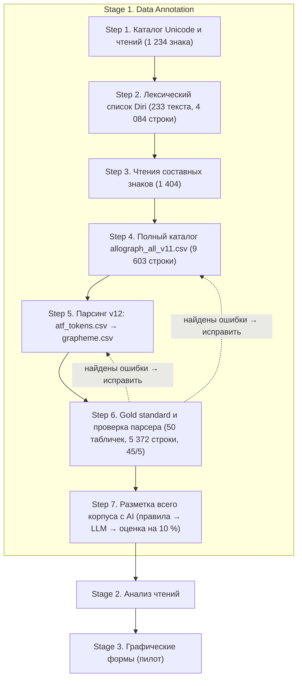

# **Руководство по разметке v2: Gold Standard (Step 6) и разметка корпуса с AI (Step 7)**

*Диссертация:* Signs and Their Readings in School and Other Texts of the Old Babylonian Period: A Quantitative Analysis
*Версия:* 2.0 (2026-11-09), подготовлено с Claude.
*Что изменилось по сравнению с v1:*
- работа встроена в workflow диссертации как два новых шага Stage 1, **Step 6** и **Step 7**, а не «Step 5»;
- внутренние названия «Stage A–G» заменены подшагами 6.1–6.8 и 7.1–7.5;
- исправлены цифры индекса OSL.

*Статус:* пока не выполнен Step 6.8 (ручная проверка человеком), разметка остаётся **кандидатом в gold (silver standard)**.

## **1. Полный Workflow (Full Workflow)**

| Этап / шаг | Статус | Что даёт |
|---|---|---|
| Stage 1, Steps 1–4 | сделано | каталог знаков (Unicode, чтения, составные знаки) |
| Stage 1, Step 5 | сделано (версия v12) | первый разбор 167 школьных табличек; ещё не проверен |
| **Stage 1, Step 6** | **сделано до 6.7; 6.8 = ручная проверка** | gold standard; измеренные типы ошибок Steps 4–5 |
| **Stage 1, Step 7** | **скрипты готовы; нужно запустить** | размеченный корпус `grapheme.csv` v2 для Stage 2 |
| Stage 2 | следующий | инвентари, индекс Жаккара, сеть, статистика (только `include_in_analysis = 1`) |
| Stage 3 | пилот | `sign_variant_id` добавляется в тот же формат на уровне знака |

*Зачем два новых шага.* Step 6 отвечает на открытый вопрос «How would you recommend validating the parser?». Step 7 отвечает на второй открытый вопрос: он измеряет долю нераспознанных знаков **по каждому корпусу**, и различия между корпусами можно проверить ещё до сравнения.

## **2. Step 6: Gold Standard и проверка парсера (Gold Standard And Parser Validation)**

*Цель:* вручную проверенная стратифицированная выборка с разметкой на уровне знака. Она нужна, чтобы (а) измерить качество парсера и (б) дать AI в Step 7 примеры и проверочные данные.

**6.1 Решения о разметке (Annotation Decisions)**
- *Единица:* одна строка = одно употребление знака (принцип `grapheme.csv`). Составной знак, записанный через `.` (|KA₂.GAL| *abul*), даёт по строке на компонент с общим `reading_unit_id`. Лигатуры с ×, &, % дают одну строку.
- *Функция:* LOGO / SYLL определяются по языку и контексту, а не по регистру букв.
- *Согласовано с руководителем:* DET и NUM исключаются из анализа, но остаются в данных (`include_in_analysis = 0`), чтобы текст таблички оставался полным (принцип CoNLL-U).

**6.2 Диагностика Steps 4 и 5 (Diagnosis)**
Готовый разбор (`atf_tokens.csv`, `grapheme.csv`, скрипты v12) я сравнила с исходным ATF и с OSL. Не распознавались очень частые чтения (`ka`, `du11`, `inim`, `šum2`, `zu2`), а это указывает на структурную причину. Найденные ошибки собраны в разделе 4.

**6.3 Инструменты (Tools: `goldlib.py`, `stage_c_tools.py`)**
1. *Индекс OSL.* `osl.asl` читается напрямую. В файле 11 411 строк `@v` в 3 309 записях `@sign`. Значения-леммы (`%akk …`) пропускаются, поэтому в индексе 11 292 значения (9 776 разных) для 4 321 знака и формы `@form`. Приоритет: значение знака → значение формы `@form` → устаревшее `@v-`.
2. *Нормализация C-ATF:* sz → š, s, → ṣ, t, → ṭ, j / ĝ → ŋ, ḫ → h, цифры индекса в подстрочные (du11 → du₁₁), индекс x → ₓ.
3. *Токенизатор* (табличка → строка → слово → знак) учитывает все пометки издателя:
   - `_..._` переключает на второй язык текста: в аккадском тексте это шумерограммы, в шумерском аккадские слова;
   - `[ ]` восстановлено, `< >` пропущено писцом, `<< >>` лишнее, `#` повреждено, `?` неуверенно, `!` исправлено, `*` сверено;
   - `{d}` детерминатив, `{+ga}` фонетический комплемент, `{{...}}` глосса;
   - `%a` / `%s` переключение языка и `=` разделитель колонок в лексических списках;
   - `reading(SIGN)`, `reading!(SIGN)`, числа `2(u)`, `1/2(diš)`, современная запись `1.30`.

**6.4 Стратифицированная выборка (Stratified Sample: `select_sample.py`, seed 20261109)**
Выборка шла из 16 906 старовавилонских табличек, у которых есть и ATF, и метаданные CDLI. Фильтры: не меньше 75% читаемых знаков; 25–260 знаков у школьных табличек и 30–260 у остальных; язык шумерский или аккадский. Если строки `#atf: lang` нет (так у 329 из 717 школьных табличек), язык берётся из колонки CDLI `languages`, а для лексических списков ставится шумерский (`assumed_lexical`). Внутри каждой группы таблички подбирались так, чтобы охватить как можно больше мест находок.

| Группа (corpus_group) | Таблички | Строки знаков | Строки в анализе | LOGO | SYLL |
|---|---|---|---|---|---|
| SCHOOL (is_school_text = 1) | 20 | 1 383 | 1 036 | 604 | 475 |
| ADMINISTRATIVE | 6 | 665 | 530 | 225 | 315 |
| LEGAL | 6 | 795 | 664 | 246 | 434 |
| LETTER | 6 | 899 | 838 | 108 | 744 |
| LITERARY | 4 | 1 013 | 924 | 343 | 614 |
| LEXICAL | 4 | 418 | 358 | 300 | 78 |
| SCHOLARLY | 4 | 199 | 154 | 42 | 116 |
| **Всего** | **50** | **5 372** | **4 504** | **1 868** | **2 776** |

- Подгруппы школьных: Lexical 8, Wisdom or proverb 5, Business / Contracts 3, Literary 3, прочее 1.
- 13 мест находок плюс «uncertain» / без места; 32 шумерских и 18 аккадских табличек.
- *Предложенное правило «жанр → корпус»* (решает первый указанный жанр CDLI; это открытый вопрос):
  - Lexical, Thematic word list → LEXICAL;
  - Administrative, Account, Receipt → ADMINISTRATIVE;
  - Legal, все Contracts, Inheritance, Judicial, Marriage, Dowries, Adoption → LEGAL;
  - Letter → LETTER;
  - Literary, Wisdom, Prayer, Incantation, Ritual → LITERARY;
  - Mathematical, Scholarly, Divination, Medical → SCHOLARLY;
  - is_school_text = 1 → SCHOOL при любом жанре.

**6.5 Автоматическая разметка (Automatic Annotation: `build_gold.py`)**

*Определение знака.*
- Каждый фрагмент ищется в OSL в порядке: обычное значение → значение `@form` → устаревшее.
- Для уточнённого чтения берётся знак в скобках.
- Прописные ищутся сначала как имя знака, потом как значение (ARAD₂ → |ARAD×KUR|).
- Если у значения в OSL несколько знаков (58 строк: *lil₂*, *he₂*, *idigna* …), берётся первый, остальные записываются в `alt_candidates`, а строка получает флаг. Одно предпочтение задано вручную: *babila₂* → |KA₂.AN.RA|.
- `x` даёт UNCLEAR; `[...]`, `...`, `~` строк не дают.

Нераспознанными остались только 4 строки из 5 372.

*Правила функции.*
- **Определения.** **LOGO**: знак пишет слово или лексическую морфему целиком. **SYLL**: знак пишет звуки (слог фонетического написания, грамматическую морфему, фонетический комплемент, глоссу). **DET**: классификатор. **NUM**: запись числа. **UNCLEAR**: знак не читается или не определён.
- **Аккадские тексты.**
  - Внутри `_..._` действуют шумерские правила (`_dumu_` L; `_in-tuku_` S L; `_1(diš)-kam_` N S). Вне подчёркивания знак SYLL.
  - Шумерские имена богов из списка после `{d}` дают LOGO и без подчёркивания (utu, suen, nanna, inanna, iškur, marduk, en-lil₂, nin-šubur, nin-urta, nisaba, uraš, nusku, mar-tu …). Остальные имена богов дают SYLL с флагом (`{d}a-šur`).
  - Логографические первые элементы личных имён (dumu-, lu₂-, dingir-, ARAD₂-, puzur₄-) дают LOGO с флагом.
  - MEŠ после логограммы даёт DET с флагом.
  - Логограмма + `{ki}` даёт LOGO (`adab{ki}`); топоним, записанный по слогам, даёт SYLL (`ma-ri{ki}`).
- **Шумерские тексты.**
  - Корень, существительное или глагольная основа дают LOGO; цепочка глагольных префиксов даёт SYLL; суффиксы, падежные показатели, притяжательные, связка и фонетические комплементы дают SYLL; удвоенный корень даёт LOGO LOGO. Примеры: `mu-un-du₃-a` S S L S; `ba-an-ti` S S L; `ku₃-ga-ke₄-eš` L S S S; `gi₄-gi₄` L L.
  - Абстрактное *nam-* перед существительным даёт LOGO, модальное *nam-* перед префиксами SYLL.
  - В оборванном глаголе префиксы дают SYLL (`mu-un-[...]`).
  - `_..._` здесь обозначает аккадские слова: SYLL.
  - Аккадские имена в шумерских текстах дают SYLL, но логограмма бога в них остаётся LOGO (`ib-ni-{d}suen` S S D L).
- **Лексические списки.**
  - Слово-классификатор в начале статьи (Ur₅-ra `gesz esi`) даёт DET с флагом (74 строки).
  - Знаки, названные по имени (`NA₂`, `UNKEN`), дают LOGO с флагом.
  - Колонки после `%a` размечаются по аккадским правилам, глоссы дают SYLL.
- **Пометки издателя.** Считаются только знаки, которые физически есть на табличке. Восстановленные `[ ]`, вставленные `< >` и лишние `<< >>` получают `include_in_analysis = 0`, но метка функции у них сохраняется. Повреждённые `#` и неуверенные `?` знаки считаются.

**6.6 Проверка по типам слов (Review By Word Types: `dump_words.py`, `word_overrides.csv`)**
Я просмотрела каждый уникальный тип шумерского слова (580 многознаковых типов в последнем круге) и каждый нетривиальный тип аккадского слова.
- Систематические ошибки исправлялись в правилах, в несколько кругов: префиксы, аккадские имена в шумерских текстах, редупликация, *nam-*, имена богов, оборванные глаголы.
- Одна эвристика ухудшала результат (*suen* становился силлабическим), и её пришлось ограничить.
- Оставшиеся случаи, зависящие от конкретного слова, оформлены как **103 решения на уровне слова** (387 строк), у каждого есть примечание.

**737 строк** получили флаг `needs_check = 1`, причина записана в `check_reason`.

**6.7 Разбиение 90 / 10 и экспорт (Split And Exports: `finalize_gold.py`)**
Разбиение сделано **по табличкам**, чтобы ни одна табличка не попала в обе части. Валидационные таблички подобраны так, чтобы дать около 10% знаков: 2 школьные и 3 практические из разных корпусов, на обоих языках.
- P209784 (школа, пословицы, шумерский);
- P251826 (школа, аккадский);
- P223292 (письмо, шумерский);
- P478899 (литературный, шумерский);
- P423699 (лексический, аккадский).

Обучение: 45 табличек / 4 835 строк. Проверка: 5 табличек / 537 строк (10,0%).

Проверки:
- правила без ручных решений совпадают с проверенной разметкой на 97,1% строк (шумерский 95,8%, аккадский 98,7%). Цифра оптимистична, потому что правила дорабатывались на тех же табличках;
- парсер v12 на 10 общих школьных табличках нашёл 11 LOGO, а в gold их 214;
- сборка с нуля даёт идентичный `gold_signs.csv`, то есть результат воспроизводим.

**6.8 Проверка человеком (Human Verification, нужно сделать)**
- Записывать решения можно двумя способами. (A) Править `gold_signs.csv` прямо в файле: `human_verified = 1`, исправленная метка, причина в `human_correction_note`. (B, рекомендую) Записывать каждое исправление строкой в `corrections.csv` (`scope,key,field,value,note,still_check`, например `token,P209784_w3_s1,sign_function,SYLL,причина,0`) и пересобирать командой `build_gold.py osl.asl <папка> <папка>/corrections.csv`. Такие строки получают `annotation_status = human_correction` и `human_verified = 1`, и решения сохраняются при каждой пересборке.
- Минимум: все 737 строк с `needs_check = 1` и все 537 строк 5 валидационных табличек. Сверка идёт по OSL, а где нужно, по фото или прорисовке.
- Рекомендация: второй аннотатор на валидационных табличках, чтобы посчитать согласие аннотаторов (κ Коэна через `evaluate.py`).

После 6.8 данные становятся gold standard.

**Колонки `gold_signs.csv` (Columns)**

| Колонка | Значение |
|---|---|
| `split` | train / val |
| `artifact_id`, `corpus_group`, `genre_cdli`, `provenience`, `is_school_text`, `atf_lang` | метаданные таблички |
| `surface`, `column`, `line_num`, `line_ref` | место на табличке |
| `word_id`, `word_index`, `raw_word` | слово ATF точно как в источнике |
| `sign_index`, `reading_unit_id`, `raw_sign` | знак как записан в ATF, с пометками |
| `reading` | нормализованное чтение (как в OSL) |
| `sign_name`, `unicode_id`, `sign_grapheme` | знак OSL, код(ы) Unicode, клинописный глиф |
| `is_compound`, `component_position`, `component_name` | строение составного знака |
| `sign_function` | LOGO / SYLL / DET / NUM / UNCLEAR |
| `include_in_analysis` | 1 = LOGO или SYLL и знак физически есть на табличке |
| `word_lang` | sux / akk после переключений `%a` и `_..._` |
| `damage_state` | intact, damaged, uncertain, collated, restored, supplied, superfluous |
| `corrected` | 1 = исправление издателя `!` |
| `resolution`, `n_candidates`, `alt_candidates` | как знак найден в OSL; другие возможные знаки |
| `function_rule` | правило, которое поставило функцию |
| `needs_check`, `check_reason` | флаг проверки и его причина |
| `annotation_status`, `annotator_note` | claude_type_review / claude_word_override (+ примечание) |
| `human_verified`, `human_correction_note` | заполняются в Step 6.8 |

## **3. Step 7: Разметка всего корпуса с AI (AI-Assisted Annotation Of The Whole Corpus)**

*Цель:* разметить около 16 900 старовавилонских табличек в формате gold standard и измерить долю ошибок.

*Что здесь значит «обучение на 90%».* LLM **не переобучается**. Она получает правила (`ai_system_prompt.md`) и **примеры** только из 45 обучающих табличек (few-shot). 5 валидационных табличек никогда не показываются как примеры; они нужны только для оценки результата. На тех же данных при необходимости можно обучить и ML-разметчик (например, CRF).

1. **7.1 Черновик правилами (Rule Draft: `annotate_corpus.py`).** Поиск по OSL + правила функции из Step 6.5, без ручных решений; трудные строки получают флаг.
   - Валидация: `ONLY_SPLIT=val python3 scripts/annotate_corpus.py osl.asl data/gold_sample_tablets.csv corpus/gold_corpus_atf val_rules.csv`.
   - Весь корпус: `data/corpus_tablet_stats.csv` и папка `practOBP_Prov_Genre` (плюс `OBP.atf`).
2. **7.2 Исправление LLM (LLM Correction: `ai/run_llm_annotation.py`).** Таблички длиннее 300 слов делятся на части (`--max-words`), потому что в самой большой табличке (P249253) около 19 000 знаков. `--only-flagged` отправляет только части со строками с флагом. Для каждой таблички или части Claude получает правила, примеры из train и черновик. В ответ он возвращает исправленные метки по словам через принудительный вызов инструмента, то есть строгий JSON.
   - Команда: `python3 ai/run_llm_annotation.py val_rules.csv data/gold_train.csv val_llm.csv --model claude-sonnet-5-5`. Сначала запустите с `--dry-run`, чтобы посмотреть промпты.
   - Нужны `pip install anthropic` и `ANTHROPIC_API_KEY`.
   - *7.2b Вариант без AI* (`scripts/apply_lexicon.py`; добавлен в пакет вне этого разговора, я его проверила): типы слов, выученные из train, заменяют метки правил. На валидации словарь покрывает 37,3% слов и не меняет ни одной метки; точность остаётся 0,972.
3. **7.3 Оценка на 10% (Evaluation: `scripts/evaluate.py data/gold_val.csv val_llm.csv report.md`).** Считаются: точность знака и Unicode, точность функции, precision / recall / F1 по классам, macro-F1, κ Коэна, матрица ошибок, результаты по корпусам и языкам, а также список всех ошибок для качественного разбора. Составной знак считается один раз (498 единиц чтения).
   - *Базовый уровень правил:* точность функции 0,972, macro-F1 0,987, κ 0,955, LOGO / SYLL 0,967. Точность знака 1,000 пока ничего не говорит: знаки в gold получены тем же поиском по OSL. Осмысленной эта цифра станет после Step 6.8.
   - *Критерий:* LLM используется, только если на валидации она лучше базового уровня правил.
4. **7.4 Полный прогон и выборочная проверка (Full Run And Spot Check).** Шаги 7.1 и 7.2 запускаются на всех табличках. Шаг 7.1 на всём корпусе я проверила: из 16 906 табличек строки знаков дают 15 676 (у остальных 1 230 нет пронумерованных строк текста, например `$ (ATF deleted, = P117511)`). Получается 2 493 716 строк знаков, 7,2% из них с флагом; работа занимает около 1,5 минуты, CSV весит около 600 МБ. Шаг 7.2 на всём корпусе означает около 16 300 запросов: сначала сделайте пилот (`--limit 50`) и посмотрите число токенов в логе, прежде чем решать. Случайная выборка строк с флагом по каждому корпусу проверяется вручную, и доля ошибок указывается по корпусам. Новые решения добавляются в `word_overrides.csv`, так что правила улучшаются с каждой проверкой.
5. **7.5 Результат для Stage 2 (Output).** `scripts/corpus_quality.py <файл.csv> quality.md` показывает по каждому корпусу долю единиц в анализе, нераспознанных знаков, UNCLEAR и строк с флагом, а также соотношение LOGO : SYLL. Для черновика правилами по всему корпусу: нераспознано 0,35% в целом и 3,95% в LEXICAL; LOGO : SYLL 0,09 в LETTER и 1,84 в LEXICAL. Итог: `grapheme.csv` v2 в формате gold, с долей нераспознанных и помеченных знаков **по каждому корпусу**. Это ответ на открытый вопрос о нераспознанных токенах. Stage 2 работает только со строками `include_in_analysis = 1`.

## **4. Ошибки в данных, найденные в Step 6 (Data Problems)**

| Место | Описание | Тип ошибки |
|---|---|---|
| `8_allograph_all_v11.csv` (Step 4) | у 226 из 1 234 знаков Unicode нет строки простого чтения (KA, SUM, TE, GAN, GUL, IL₂, U …) | ошибка каталога (структурная причина нераспознанных токенов) |
| `8_allograph_all_v11.csv` | у простых строк KA×U, KA×UD стоит sign_name «KA» | ошибка каталога |
| `1_transferTrLit_Sign_v12.py` (Step 5) | `_` не удаляется (`_lugal_` не находится); `<...>` и `<<...>>` стираются, и вставленные и стёртые знаки считаются написанными | ошибка парсера |
| `1_transferTrLit_Sign_v12.py` | `x` (нечитаемый знак) превращается в знак каталога X и считается засвидетельствованным | ошибка парсера |
| `2_txt_to_grapheme_v12.py` (Step 5) | LOGO / SYLL по регистру букв: 11 LOGO на 10 общих школьных табличках, в gold 214 | ошибка метода (открытый вопрос подтвердился) |
| `2_txt_to_grapheme_v12.py` | `lexical` → SCHOOL смешивает лексический и школьный корпус; «Business / Contracts» не получает corpus_id | ошибка соответствия |
| Метаданные CDLI | у 329 из 717 школьных табличек нет `#atf: lang`; у 392 нет жанра; P229166 (Ur₅-ra) записан как «Business / Contracts» | ошибка исходных данных |
| ATF CDLI | P272792 это аккадское письмо без `#atf: lang`; логограммы не подчёркнуты | ошибка исходных данных |

## **5. Открытые решения для руководителей (Open Decisions)**

1. Шумерские местоимения и вопросительные слова, записанные фонетически (`za-e`, `e-ne`, `a-na`): SYLL (сейчас) или LOGO?
2. Слова-классификаторы в начале статей лексических списков: DET (сейчас) или часть статьи (LOGO)?
3. Показатель множественного числа MEŠ: DET (сейчас) или LOGO?
4. Знаки, названные по имени в списках знаков: LOGO (сейчас) или отдельный класс (META)?
5. Восстановленные знаки `[ ]`: исключать (сейчас) или считать?
6. Правило «жанр → корпус» (Step 6.4).

## **6. Файлы по шагам (Files By Step)**

| Шаг | Скрипт | Результат |
|---|---|---|
| 6.3 | `scripts/goldlib.py`, `scripts/stage_c_tools.py` | индекс OSL, токенизатор |
| 6.4 | `scripts/select_sample.py` | `data/gold_sample_tablets.csv`, `corpus/gold_corpus_atf/`, `data/corpus_tablet_stats.csv` |
| 6.5–6.6 | `scripts/build_gold.py`, `scripts/word_overrides.csv`, `scripts/dump_words.py` | `data/gold_signs.csv` |
| 6.7 | `scripts/finalize_gold.py` | `data/gold_train.csv`, `data/gold_val.csv`, `data/gold_signs.conllu`, `data/gold_stats.json` |
| 6.8 | (вручную) | колонка `human_verified` |
| 7.1 | `scripts/annotate_corpus.py` | черновик правилами |
| 7.2 | `ai/run_llm_annotation.py`, `ai/ai_system_prompt.md` (7.2b: `scripts/apply_lexicon.py`) | исправленная разметка |
| 7.3 | `scripts/evaluate.py` | `evaluation/eval_rules_baseline_val.md`, `evaluation/eval_lexicon_val.md` |
| 6.8 | `corrections.csv` + `scripts/build_gold.py` | решения человека, которые сохраняются при пересборке |
| 7.5 | `scripts/corpus_quality.py` | отчёт о качестве по корпусам; `grapheme.csv` v2 |
